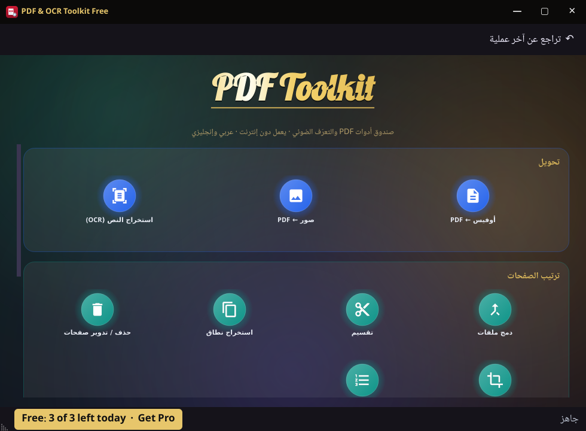

# PDF Toolkit Free

**A full offline PDF toolbox with Arabic + English OCR — for Windows, Linux and Android.**
Nothing is uploaded: every tool runs on your own computer.

## Download

👉 **[Latest release](https://github.com/Q8core/PDF-Toolkit-Free/releases/latest)**

| System | File |
|---|---|
| Windows 10 / 11 (64-bit) | `PDF-Toolkit-Free-1.0.0-windows-x64.zip` — unzip, run `PDF Toolkit Free.exe` |
| Linux x64 (Mint 22+, Ubuntu 24.04+, Debian 13+) | `PDF-Toolkit-Free-1.0.0-linux-x64.tar.gz` — extract, run `./"PDF Toolkit Free"` |
| Android 7+ | `PDF-Toolkit-Free-1.0.0-android.apk` — open it on your phone and allow "Install unknown apps" |

Checksums are in `SHA256SUMS.txt` on the release page.

## Free vs Pro

| | Free | Pro |
|---|---|---|
| Every tool below | ✅ | ✅ |
| Results per day | 3 | Unlimited |
| Price | Free | **$24.99 one-time** |

**[Get PDF Toolkit Pro →](https://q8core.com/app/pdf-toolkit.html)**
Already have a key? Tap the **Free · Get Pro** bar in the app, then **Enter key**.
Activation needs internet once; after that it works offline.

## Tools

Windows and Linux:

- **Organize:** merge, split, extract a page range, delete / rotate pages, crop margins, page numbers
- **Convert:** images → PDF, PDF → JPG / PNG, Office → PDF (needs LibreOffice installed)
- **OCR (Arabic + English, offline):** extract editable text, or make a searchable PDF from a scan
- **Secure:** AES-256 password, unlock, redact, watermark, signature stamp
- **Fix:** compress, repair, compare two PDFs

Android: merge, split into pages, delete pages, rotate, images → PDF, and Arabic + English OCR text extraction.

Your original files are never changed — every tool writes a new file, and **Undo** removes the last result.

## More apps by Q8Core

| App | What it does | Platforms |
|---|---|---|
| [PDF Toolkit Pro](https://q8core.com/app/pdf-toolkit.html) | This app, no daily limit | Windows · Linux · Android |
| [DeviceDeck](https://q8core.com/app/devicedeck.html) | Mirror & control Android from your PC | Windows · Linux · Android |
| [CodeForge](https://q8core.com/app/codeforge.html) | Learn Bash & Python 0→100 with a live runner | Windows · Linux · Android |
| [Qore Guardian](https://q8core.com/app/qore-guardian.html) | Keep archive drives clean, whole and repairable | Windows · Linux |
| [FolderLock](https://q8core.com/app/folderlock.html) | Encrypt folders with AES-256 | Windows · macOS · Linux |
| [DriveSync](https://q8core.com/app/drivesync.html) | Mirror, sync & back up drives | Windows · macOS · Linux |
| [Study Planner](https://q8core.com/app/study-planner.html) | Plan, take notes and revise smarter | Windows · macOS · Linux · Android |

**All apps: [q8core.com](https://q8core.com)**

---

النسخة المجانية: كل الأدوات، حتى 3 نتائج يوميًا. النسخة الكاملة بلا حدود من [q8core.com](https://q8core.com/app/pdf-toolkit.html).

Freeware, closed source. Built with open-source components — see `THIRD-PARTY-NOTICES.txt` in the download.
